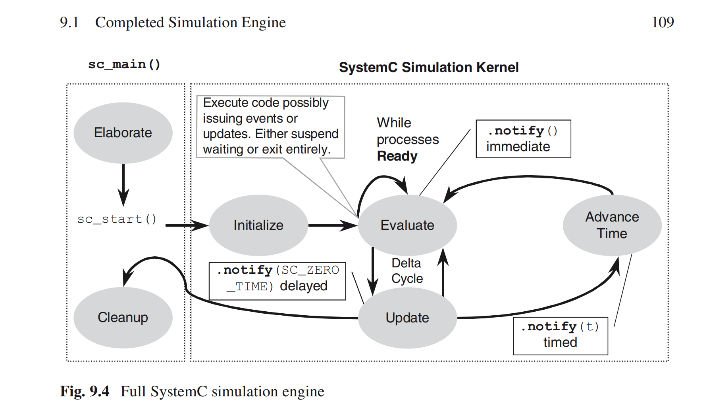
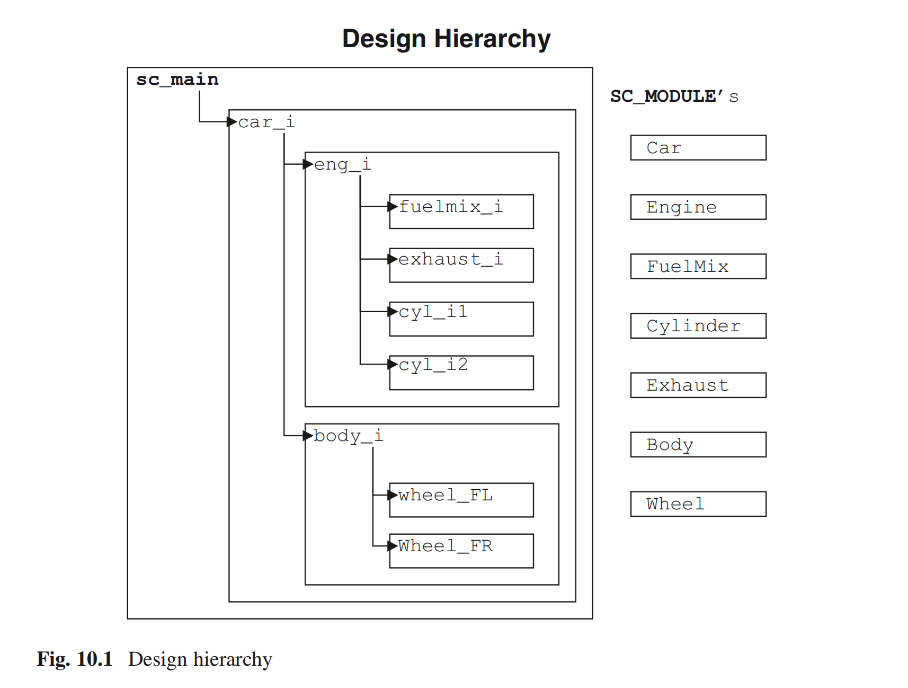
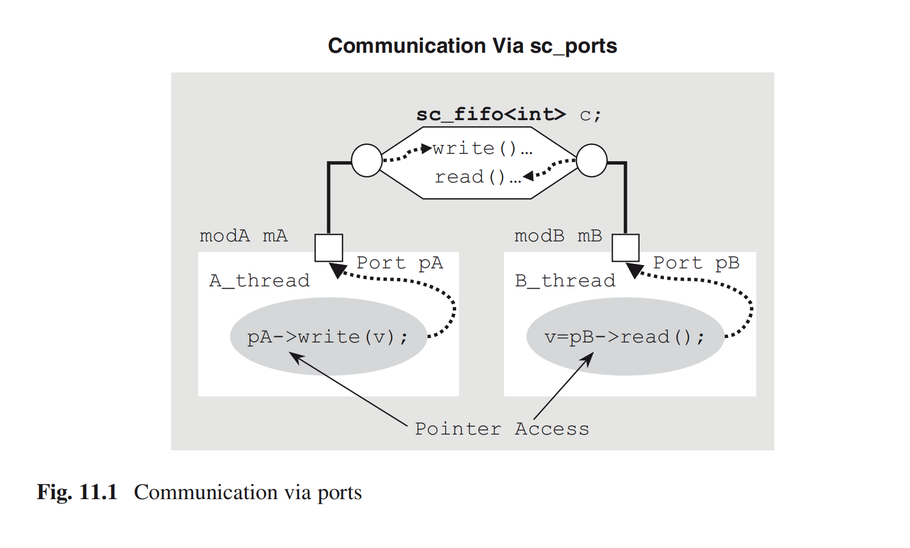

## 一、SystemC 数据类型

### 1.1 类型分类

| 类别 | 代表类型 | 适用场景 |
| --- | --- | --- |
| 原生 C/C++ 类型 | `int`、`double`、`bool` 等 | 只需要普通软件数值运算，速度最快 |
| 二值逻辑 | `sc_bv<W>` | 只包含 0/1 的位向量 |
| 四值逻辑 | `sc_logic`、`sc_lv<W>` | 需要 0/1/X/Z 等硬件逻辑状态 |
| SystemC 整数 | `sc_int<W>`、`sc_uint<W>` | 需要显式位宽的有符号/无符号整数 |
| 大整数 | `sc_bigint<W>`、`sc_biguint<W>` | 位宽超过 64 位；功能强但速度较慢 |
| 定点数 | `sc_fixed`、`sc_ufixed` 及其 fast 版本 | 需要整数位/小数位划分的数值建模 |

### 1.2 二值逻辑：`sc_bv<W>`

`sc_bv<W>`（bit vector）只有 **0 和 1** 两种取值，`W` 指定位宽。它支持位选择、区间选择、按位运算和归约运算。

常用归约方法：

- `and_reduce()`
- `or_reduce()`
- `nand_reduce()`
- `nor_reduce()`
- `xor_reduce()`
- `xnor_reduce()`

示例：

```c++
sc_bv<5> positions = "01101";
sc_bv<6> mask      = "100111";

sc_bv<5> active = positions & mask;       // 00101
sc_bv<1> all    = active.and_reduce();    // SC_LOGIC_0

positions.range(3, 2) = "00";             // 00001
positions[2] = active[0] ^ flag;
```

### 1.3 四值逻辑：`sc_logic` 与 `sc_lv<W>`

四值逻辑用于表达硬件仿真中的未知态和高阻态：

| 语义 | SystemC 常量 | 字符表示 |
| --- | --- | --- |
| 逻辑 0 | `SC_LOGIC_0`、`Log_0` | `'0'` |
| 逻辑 1 | `SC_LOGIC_1`、`Log_1` | `'1'` |
| 高阻态 | `SC_LOGIC_Z`、`Log_Z` | `'z'` 或 `'Z'` |
| 未知态 | `SC_LOGIC_X`、`Log_X` | `'x'` 或 `'X'` |

`sc_lv<W>` 支持位选择、区间选择，以及与 `sc_bv<W>` 相同的六类归约运算。

示例：

```c++
sc_lv<5> positions = "01xz1";
sc_lv<6> mask      = "10Zx11";

sc_lv<5> active = positions & mask;       // 0xxx1
sc_lv<1> all    = active.and_reduce();    // SC_LOGIC_0

positions.range(3, 2) = "00";             // 000z1
positions[2] = active[0] ^ flag;          // !flag
```

### 1.4 整数类型

- `sc_int<W>`：有符号整数，`W` 最大支持 64 位。
- `sc_uint<W>`：无符号整数，`W` 最大支持 64 位。
- `sc_bigint<W>`：更大位宽的有符号整数。
- `sc_biguint<W>`：更大位宽的无符号整数。

大整数适合表达超过 64 位的硬件数据，但运算速度通常低于普通整数类型。

### 1.5 定点数类型

定点数通过总位宽和整数位宽共同描述数值格式：

- `WL`：总位宽（word length）
- `IWL`：整数部分位宽（integer word length）
- `QUANT`：量化模式
- `OVFLW`：溢出处理模式
- `NBITS`：相关位数参数

类型声明：

```c++
sc_fixed<WL, IWL[, QUANT[, OVFLW[, NBITS]]]>       NAME;
sc_ufixed<WL, IWL[, QUANT[, OVFLW[, NBITS]]]>      NAME;
sc_fixed_fast<WL, IWL[, QUANT[, OVFLW[, NBITS]]]>  NAME;
sc_ufixed_fast<WL, IWL[, QUANT[, OVFLW[, NBITS]]]> NAME;
```

构造形式：

```c++
sc_fix       NAME(WL, IWL[, QUANT[, OVFLW[, NBITS]]]);
sc_ufix      NAME(WL, IWL[, QUANT[, OVFLW[, NBITS]]]);
sc_fix_fast  NAME(WL, IWL[, QUANT[, OVFLW[, NBITS]]]);
sc_ufix_fast NAME(WL, IWL[, QUANT[, OVFLW[, NBITS]]]);
```

当前笔记暂未涉及定点数的具体使用；需要定点建模时，再重点确认量化和溢出策略。

### 1.6 数据类型的基本操作

SystemC 类型通常同时支持：

- 基本 C++ 运算：算术、比较、赋值、位运算等。
- SystemC 专用操作：按位选择、区间选择、类型转换、状态测试、归约运算等。

#### 常见运算符

- **比较**：`==`、`!=`、`>`、`>=`、`<`、`<=`
- **算术**：`++`、`--`、`*`、`/`、`%`、`+`、`-`、`<<`、`>>`
- **按位**：`~`、`&`、`\|`、`^`
- **赋值**：`=`、`&=`、`\|=`、`^=`、`*=`、`/=`、`%=`、`+=`、`-=`、`<<=`、`>>=`

#### 专用方法

| 功能 | 方法 |
| --- | --- |
| 位选择 | `bit(idx)`、`[idx]` |
| 区间选择 | `range(high, low)`、`(high, low)` |
| 浮点转换 | `to_double()` |
| 有符号整数转换 | `to_int()`、`to_int64()`、`to_long()` |
| 无符号整数转换 | `to_uint()`、`to_uint64()`、`to_ulong()` |
| 字符串转换 | `to_string(type)` |
| 状态测试 | `is_zero()`、`is_neg()`、`length()` |
| 与 / 与非归约 | `and_reduce()`、`nand_reduce()` |
| 或 / 或非归约 | `or_reduce()`、`nor_reduce()` |
| 异或 / 同或归约 | `xor_reduce()`、`xnor_reduce()` |

### 1.7 数据类型选择与性能

选择原则：**在满足建模语义的前提下，尽量使用接近原生的 C/C++ 类型。**

从快到慢的大致顺序：

1. 原生 C/C++ 类型，例如 `int`、`double`、`bool`
2. `sc_int<W>`、`sc_uint<W>`
3. `sc_bv<W>`
4. `sc_logic`、`sc_lv<W>`
5. `sc_bigint<W>`、`sc_biguint<W>`
6. `sc_fixed_fast`、`sc_ufixed_fast`、`sc_fix_fast`、`sc_ufix_fast`
7. `sc_fixed`、`sc_ufixed`、`sc_fix`、`sc_ufix`

因此：

- 普通算法或控制计算：优先原生类型。
- 需要固定硬件位宽：使用 `sc_int` / `sc_uint`。
- 需要位向量：使用 `sc_bv`。
- 需要 X/Z 状态：使用 `sc_logic` / `sc_lv`。
- 需要超大位宽：使用 `sc_bigint` / `sc_biguint`。
- 需要定点格式：根据精度和性能要求选择普通版或 fast 版。

## 二、模块与仿真流程

### 2.1 `sc_main`：SystemC 的入口

SystemC 从 `sc_main` 开始，类似 C++ 从 `main` 开始。一个典型的仿真入口包含三个阶段：

1. **Elaboration（建模展开）**：实例化模块，建立端口、通道和层次结构之间的连接。
2. **Simulation（仿真）**：调用 `sc_start()`，启动并运行仿真。
3. **Post-processing（后处理，可选）**：读取仿真结果、生成报告或进行数据分析。

可复制的伪代码模板：

```c++
int sc_main(int argc, char* argv[]) {
    // Elaboration：创建实例并完成连接
    // ...

    sc_start();  // Simulation begins and ends in this function

    // Post-processing：处理结果、输出报告
    // ...

    return 0;    // 0 表示成功
}
```

### 2.2 使用 `SC_MODULE` 定义模块

`SC_MODULE` 是 SystemC 模块的基本声明宏：

```c++
#include <systemc>

SC_MODULE(module_name) {
    // MODULE_BODY
};
```

它适合快速定义模块，并把模块名、模块类型和模块体组织在一起。

### 2.3 更推荐的类定义方式

也可以显式继承 `sc_module`：

```c++
#include <systemc>

class module_name : public sc_module {
public:
    // MODULE_BODY
};
```

这种写法更接近标准 C++ 类定义，适合需要清晰表达继承关系、访问控制和复杂模块结构的场景。

### 2.4 模块体（`MODULE_BODY`）应包含的内容

一个完整的模块体通常包括：

- **Ports**：输入、输出和双向端口。
- **Member channel instances**：成员通道实例。
- **Member data instances**：成员数据对象。
- **Member module instances**：子模块或子设计实例。
- **Constructor**：构造函数，用于初始化对象、连接端口和注册进程。
- **Destructor**：析构函数。
- **Simulation process member functions**：仿真进程成员函数。
- **Other methods**：其他辅助成员函数。

组织模块时，可按以下顺序书写：端口 → 通道/数据 → 子模块 → 构造函数 → 仿真进程 → 辅助方法 → 析构函数。

### 2.5 构造函数：`SC_CTOR`

模块需要通过构造函数完成初始化。SystemC 提供 `SC_CTOR(module_name)` 宏，用于声明只接收模块实例名的常规构造函数。

构造过程通常包括：

1. **初始化列表（Initialization）**：初始化基类和成员对象。
2. **子设计分配（Subdesign Allocation）**：创建子模块。
3. **子设计连接（Subdesign Connectivity）**：连接端口与通道。
4. **进程注册（Process Registration）**：注册仿真进程。
5. **其他配置（Miscellaneous Setup）**：完成额外设置。

简单设计可能只需要进程注册和基本配置；复杂设计则可能包含多个子模块和多个进程。

以下为截图转录的结构模板；初始化项和注释需要按实际模块补充：

```c++
SC_MODULE(module_name) {
    SC_CTOR(module_name)
        // : Initialization  // C++ 成员初始化列表（按需填写）
    {
        // Subdesign_Allocation
        // Subdesign_Connectivity
        // Process_Registration
        // Miscellaneous_Setup
    }
};
```

### 2.6 基本进程注册：`SC_THREAD`

**SystemC 仿真进程（simulation process）**是仿真的基本执行单位。这里的进程是模块中注册给仿真内核调用的成员函数。

`SC_THREAD` 是一种基本的进程类型，通常在构造函数中注册：

```c++
SC_THREAD(process_name);  // 在构造函数内调用
```

`process_name` 必须是该模块声明的成员函数。截图中的基本示例（Fig. 4.10）如下：

```c++
// FILE: basic_process_ex.h
SC_MODULE(basic_process_ex) {
    SC_CTOR(basic_process_ex) {
        SC_THREAD(my_thread_process);
    }

    void my_thread_process(void);
};
```

测试平台（testbench）常使用 `SC_THREAD` 进程顺序完成一系列任务，并在适当时机结束仿真。

### 2.7 自定义构造函数与 `SC_HAS_PROCESS`

当构造函数需要接收模块名以外的参数时，可显式声明 C++ 构造函数，并配合 `SC_HAS_PROCESS(module_name)` 注册进程。

**概念区分**：`SC_HAS_PROCESS` 本身不是构造函数；它为进程注册宏提供模块类型信息。自定义构造函数仍需在初始化列表中调用 `sc_module(instname)`。

截图中的声明与实现分离形式如下。这里的 `[, other_args...]`、`[, other_initializers]` 表示可选项，是语法示意，不能原样编译。

```c++
// FILE: module_name.h
SC_MODULE(module_name) {
    module_name(sc_module_name instname[, other_args...]);
};
```

```c++
// FILE: module_name.cpp
SC_HAS_PROCESS(module_name);

module_name::module_name(
    sc_module_name instname[, other_args...])
    : sc_module(instname)
    [, other_initializers]
{
    CONSTRUCTOR_BODY
}
```

### 2.8 模块代码组织：头文件与源文件分离

原笔记推荐将构造函数实现放在 `.cpp` 文件中，并通过子模块指针配合前向声明组织层次结构。这样可以将接口声明与实现细节分开。

**头文件职责**（Fig. 4.19）：声明子模块类型、端口、通道或子模块指针、构造函数、进程与辅助方法。

```c++
// FILE: NAME.h
#ifndef NAME_H
#define NAME_H

// Submodule forward class declarations
// 子模块类型的前向声明

SC_MODULE(NAME) {
    // Port declarations
    // Channel / Submodule* definitions

    // Constructor declaration
    SC_CTOR(NAME);

    // Process declarations
    // Helper declarations
};

#endif
```

```c++
// FILE: NAME.cpp
#include <systemc>
#include "NAME.h"

SC_HAS_PROCESS(NAME);

NAME::NAME(sc_module_name nm)
    : sc_module(nm)
    // , Initializations
{
    // Channel allocations
    // Submodule allocations
    // Connectivity
    // Process registrations
}

// NAME::Process { implementations }
// NAME::Helper  { implementations }
```


## 三、时间建模（Notion of Time）

### 3.1 三种时间度量

| 时间类型 | 含义 |
| --- | --- |
| Wall-clock time（墙上时间） | 现实世界中经过的时间，即运行程序所花的实际时长 |
| Processor time（处理器时间） | 处理器实际用于执行程序的时间 |
| Simulated time（仿真时间） | 模型内部所描述的时间，由仿真内核推进 |

三者不能混为一谈。例如，模型运行了 100 ns 的仿真时间，不代表计算机只花了 100 ns。

### 3.2 `sc_time`：表示时间值

`sc_time` 用于表示仿真中的时间值或时间间隔。构造时可以指定数值和单位；内部以全局时间分辨率为单位，使用至少 64 位的无符号整数刻度表示时间。

截图中的三种构造形式可以写成：

```c++
sc_time t_default;            // 未显式传入初值；默认表示零时间
sc_time t_delay(5, SC_NS);    // 数值 + 时间单位
sc_time t_copy(t_delay);      // 从已有 sc_time 对象复制
```

这里将截图中的 `name`、`double`、`const sc_time&` 等语法占位符改为具体变量，方便阅读。

### 3.3 时间单位：`sc_time_unit`

| 枚举值 | 英文单位 | 中文单位 | 相对于秒的量级 |
| --- | --- | --- | --- |
| `SC_FS` | femtoseconds | 飞秒 | 10⁻¹⁵ s |
| `SC_PS` | picoseconds | 皮秒 | 10⁻¹² s |
| `SC_NS` | nanoseconds | 纳秒 | 10⁻⁹ s |
| `SC_US` | microseconds | 微秒 | 10⁻⁶ s |
| `SC_MS` | milliseconds | 毫秒 | 10⁻³ s |
| `SC_SEC` | seconds | 秒 | 10⁰ s |

### 3.4 全局时间分辨率

时间分辨率决定仿真时间能够表达的最小步长，默认值为 **1 ps**。

- `sc_get_time_resolution()`：读取当前时间分辨率。
- `sc_set_time_resolution(double, sc_time_unit)`：设置时间分辨率。

```c++
// 初始化阶段先设置分辨率，再创建依赖它的非零 sc_time 对象。
sc_set_time_resolution(1, SC_PS);
sc_time resolution = sc_get_time_resolution();
```

**时间单位与时间分辨率不同**：可以用 ns 构造时间值，同时用 ps 作为内部计数刻度。

### 3.5 `sc_time` 的运算与转换

截图中的运算符整理如下：

- **比较**：`==`、`!=`、`<`、`<=`、`>`、`>=`
- **算术**：`+`、`-`、`*`、`/`
- **赋值**：`=`、`+=`、`-=`、`*=`、`/=`

时间值可以相加、相减和比较；乘除运算需区分操作数类型，例如时间乘以数值、时间除以数值，以及两个时间值相除得到比值。

截图示例转录如下，补齐了 `error(...)` 后缺失的分号：

```c++
sc_time t_PERIOD(5, SC_NS);
sc_time t_TIMEOUT(100, SC_MS);
sc_time t_MEASURE, t_CURRENT, t_LAST_CLOCK;

t_MEASURE = t_CURRENT - t_LAST_CLOCK;

if (t_MEASURE > t_HOLD) {
    error("Setup violated");
}
```

这是时间运算片段：`t_CURRENT`、`t_LAST_CLOCK` 应先取得实际时间值，`t_HOLD` 和 `error()` 也需要由上下文提供。截图中的阈值名称与报错文字原样保留；具体建立/保持时间检查条件需要按模型定义，不能仅凭这个片段确定。

常用转换方法：

| 方法 | 返回含义 |
| --- | --- |
| `to_double()` | 将内部时间刻度数转换为 `double`，不是直接返回秒数 |
| `to_seconds()` | 将时间值换算为以秒为单位的 `double` |

### 3.6 读取当前仿真时间：`sc_time_stamp()`

当前仿真时间由内核维护，不能通过给普通变量赋值来修改。使用 `sc_time_stamp()` 读取：

```c++
sc_time current_time = sc_time_stamp();
```

`sc_time` 支持输出流操作。截图中的打印示例如下：

```c++
cout << " The time is now "
     << sc_time_stamp()
     << "!" << endl;
```

截图给出的输出为：

> The time is now 0 ns!

该输出表示当时的仿真时间为零；零时间的显示单位可能随 SystemC 版本或设置不同。

### 3.7 启动与限定仿真时长：`sc_start()`

截图列出了三种调用形式：

```c++
sc_start();                      // 不指定运行时长上限
sc_start(sc_time(100, SC_NS));    // 最多再运行 100 ns
sc_start(100, SC_NS);             // 数值 + 单位形式
```

后两行分别对应截图中的 `const sc_time& max_sc_time` 参数形式，以及 `double max_time, sc_time_unit time_unit` 参数形式。

**参数表示从当前仿真时间起计算的运行时长，不是绝对终止时间。**例如当前时间为 20 ns，调用 `sc_start(100, SC_NS)`，通常会运行至 120 ns；停止、暂停等条件可能使其提前返回。

无参数调用没有指定时长上限，但也并非一定永远运行：显式停止或没有后续待处理活动等情况可使调用返回。

### 3.8 在线程进程中加入延迟：`wait(sc_time)`

在 `SC_THREAD` 进程中，可以使用带时间参数的 `wait` 描述延迟：

```c++
// 放在 SC_THREAD 对应的成员函数中
wait(sc_time(10, SC_NS));
```

这里表示等待 10 ns 的仿真时间，和现实中的程序运行时长无直接对应关系。

## 四、快速复习清单

### 4.1 数据类型

- `sc_bv<W>`：二值位向量，只表示 0/1。
- `sc_lv<W>`：四值位向量，可表示 0/1/X/Z。
- `sc_int<W>` / `sc_uint<W>`：最多 64 位的有符号/无符号整数。
- `sc_bigint<W>` / `sc_biguint<W>`：更大位宽，但更慢。
- `sc_fixed` / `sc_ufixed`：定点数；先明确总位宽、整数位宽、量化和溢出策略。
- 类型选择优先考虑：**语义正确性 → 位宽/状态需求 → 仿真性能**。

### 4.2 模块与进程注册

- `sc_main`：完成 elaboration、simulation、post-processing。
- `SC_MODULE` 或继承 `sc_module`：定义 SystemC 模块。
- `SC_CTOR`：声明常规模块构造函数，完成初始化、连接和进程注册。
- `SC_HAS_PROCESS`：配合自定义构造函数支持进程注册，本身不是构造函数。
- `SC_THREAD`：在构造函数中注册模块成员函数为线程进程。

### 4.3 仿真时间

- `sc_time`：表示时间值；区分时间单位与全局时间分辨率。
- `sc_time_stamp()`：读取当前仿真时间。
- `sc_start(duration)`：指定继续运行的仿真时长。
- `wait(sc_time)`：在线程进程中描述仿真延迟。

---

## 五、并发与仿真调度（Concurrency）

### 5.1 用仿真进程描述并发

SystemC 使用 **仿真进程（simulation processes）** 描述模型中的并发行为。进程由用户编写的模块成员函数实现，并在构造函数中注册给仿真内核；注册的函数没有参数，返回类型为 `void`。

本节关注两类进程：**线程进程（thread process）和方法进程（method process）**。可以在函数名末尾使用 `_thread`、`_method`，便于区分。

| 对比项 | `SC_THREAD` | `SC_METHOD` |
| --- | --- | --- |
| 执行方式 | 启动后执行，可在 `wait()` 处挂起 | 每次被触发时，从函数开头执行到返回 |
| 交还控制权 | 调用 `wait()`，或函数返回 | 函数返回 |
| 再次执行 | 等待条件满足后，从 `wait()` 后继续 | 敏感条件满足后，再从函数开头调用 |
| 函数返回的含义 | 线程结束；不会因后续敏感事件重新启动 | 本次调用结束；后续仍可再次触发 |
| 动态敏感性 | 使用带参数的 `wait(...)` | 使用 `next_trigger(...)` |

\*\*并发行为由仿真内核调度。\*\*在通常的单线程仿真内核中，一个进程持续执行，直到主动等待或返回；内核再运行其他可运行进程。进程之间需要通过事件、信号或通道同步，不能依赖同一时刻各进程的执行先后顺序。

### 5.2 简化的仿真内核流程

原图 Fig. 6.4（Simplified SystemC simulation engine）可转写为以下步骤：

1. **Elaborate（建模展开）**：在 `sc_main()` 中实例化模块并完成连接。
2. **调用 ****`sc_start()`**：进入仿真内核。
3. **Initialize（初始化）**：准备初始进程状态。
4. **Evaluate（求值）**：执行可运行进程。线程执行到 `wait()` 时挂起，执行到返回时结束；方法进程执行到返回时结束本次调用。只要还有可运行进程，就继续求值。
5. **Advance Time（推进时间）**：当前时刻的活动处理完毕后，若有未来的定时活动，将仿真时间推进到下一活动时刻，再回到求值阶段。
6. **返回与清理**：没有后续活动或执行停止条件（如 `sc_stop()`）时，仿真结束并返回 `sc_main()`，继续后处理与清理。

这是原图的简化模型；信号更新和 delta 通知等细节将在下面区分。**调用 ****`wait()`**** 表示当前线程让出执行权，具体何时恢复由等待条件决定。**

## 六、事件与线程等待

### 6.1 `sc_event`：表示某一时刻发生的事件

SystemC 事件表示某一时刻发生的事情，**没有数值，也没有持续时间**，通过 `sc_event` 建模。Fig. 6.12 的声明语法可写成：

```c++
sc_event event_name;
sc_event event_name1, event_name2;
```

围绕事件的基本操作是：

- **等待通知**：线程调用 `wait(event_name)`，或为进程建立敏感性。
- **发出通知**：调用 `event_name.notify(...)`。

\*\*事件不保存已经发生的通知。\*\*进程必须在通知发出前建立等待或敏感关系，才能被该通知唤醒；事后调用 `wait()` 无法补收之前的通知。

### 6.2 `notify()`：即时、零时间与定时通知

Fig. 6.13 的四种调用形式整理如下。每行表示一种独立用法；原图的 `void`、类型名和单位占位符已改为实际调用语法。

```c++
event_name.notify();                       // 即时通知：Immediate
event_name.notify(SC_ZERO_TIME);           // 零时间通知：delta notification
event_name.notify(sc_time(5, SC_NS));       // 定时通知：Timed，延迟大于 0
event_name.notify(5, SC_NS);                // 数值 + 时间单位的便捷形式
```

| 通知形式 | 何时生效 | 仿真时间是否前进 |
| --- | --- | --- |
| `notify()` | 在当前求值阶段，使相应的等待进程成为可运行进程 | 否 |
| `notify(SC_ZERO_TIME)` | 在当前求值及更新阶段结束后的 delta 通知阶段生效，等待进程在后续 delta 周期运行 | 否 |
| `notify(delay)`，且 `delay > SC_ZERO_TIME` | 在当前仿真时间加上 `delay` 时生效 | 是，在内核处理到该定时时刻时 |

\*\*即时通知也不会抢占当前正在执行的进程。\*\*当前进程仍要执行到等待或返回，内核才有机会运行被唤醒的进程。

\*\*零时间通知会改变调度阶段，但保持相同的仿真时间戳。\*\*原笔记中“所有可运行进程都完成”应理解为当前求值阶段的进程都已挂起或返回，随后还会处理更新阶段，再发出 delta 通知。

### 6.3 取消通知与单个事件的限制

尚未发出的 delta 通知或定时通知可以取消：

```c++
event_name.cancel();
```

`cancel()` 取消的是待发出的通知；已经发生的通知无法撤回。

一个普通 `sc_event` **最多保留一个待发出的 delta / 定时通知**，不能把多次 `notify()` 当作事件队列使用。多个定时通知竞争时，保留更早的通知；需要保留多个独立的计划通知时，应使用 `sc_event_queue`。

### 6.4 在 `SC_THREAD` 中使用 `wait()`

线程使用 `wait()` 挂起，并由指定条件唤醒：

| 调用形式 | 恢复条件 |
| --- | --- |
| `wait(event)` | 指定事件通知发生 |
| `wait(event1 \\| event2)` | 任一事件通知发生 |
| `wait(event1 & event2)` | 列表中的事件都已通知过 |
| `wait(delay)` | 指定仿真时间经过 |
| `wait(timeout, event)` | 事件通知发生，或超时时间到达 |
| `wait(timeout, event1 \\| event2)` | 任一事件通知发生，或超时时间到达 |
| `wait(timeout, event1 & event2)` | 所有事件均已通知过，或超时时间到达 |
| `wait()` | 等待该线程的静态敏感列表中的事件 |

其中 `delay`、`timeout` 为 `sc_time` 时间值；纯时间等待还可写成 `wait(10, SC_NS)`。事件列表中的 `\|` 表示“任一”，`&` 表示“全部”，全部事件无需在同一时刻发生。

### 6.5 带超时的等待示例

Fig. 6.17 使用“应答事件或总线错误事件，再加最大等待时间”控制线程。以下保留原图变量名，将省略部分写成注释并补齐右花括号：

```c++
sc_event ack_event, bus_error_event;
// ...

sc_time start_time(sc_time_stamp());
wait(t_MAX_DELAY, ack_event | bus_error_event);

if (sc_time_stamp() - start_time == t_MAX_DELAY) {
    break;  // path for a time out
}
// ...
```

这是线程内等待逻辑的片段：事件声明通常放在可供通信双方访问的模块作用域中；`t_MAX_DELAY` 由外围代码定义，`break` 需要位于循环或 `switch` 内。

- 在 `t_MAX_DELAY` 之前收到任一事件通知：线程提前恢复。
- 没有更早的事件通知：达到最大等待时长后恢复，示例进入超时分支。
- 事件恰好在超时边界通知：仅凭时间差相等无法区分原因，需要结合模型中的状态判断。

### 6.6 `sc_event_queue`：保留多个计划通知

`sc_event_queue` 可以保留多个尚未发生的通知，包括安排在同一仿真时刻的多个通知。

```c++
sc_event_queue action;

action.notify(2, SC_NS);
action.notify(5, SC_NS);
action.notify(8, SC_NS);
```

假设调用时的仿真时间均为 **10 ns**，三个通知分别安排在 **12 ns、15 ns、18 ns**，都会保留。

在线程中，可等待队列的默认事件：

```c++
wait(action.default_event());
```

同一仿真时刻的多个队列通知会在不同 delta 周期发出。队列保存的是计划通知；进程仍需提前建立等待或敏感关系。

## 七、方法进程（SystemC Method Process）

### 7.1 使用 `SC_METHOD` 注册

Fig. 6.29 的注册语法如下，放在模块构造函数内部：

```c++
SC_METHOD(process_name);
```

`process_name` 对应模块中无参数、返回 `void` 的成员函数。方法进程每次触发都会从函数开头执行，直到返回；**不允许调用 ****`wait()`****，也不能通过其调用的辅助函数间接执行 ****`wait()`**。

可以将它与事件触发的 Verilog `always` 行为类比。需要跨多次调用保存的状态，应放在模块成员等持久对象中。

### 7.2 `next_trigger()`：指定下一次触发条件

`SC_METHOD` 使用 `next_trigger()` 设置动态敏感性。**它只设置下一次触发条件，当前函数会继续向后执行，直到返回。**

Fig. 6.30 的全部形式转写如下。其中 `delay`、`timeout` 为 `sc_time` 对象，`event`、`event1`、`event2` 为 `sc_event` 对象；每行表示一种独立用法。

```c++
next_trigger(delay);                      // 时间到达
next_trigger(10, SC_NS);                  // 数值 + 时间单位
next_trigger(event);                      // 单个事件
next_trigger(event1 | event2);            // 任一事件
next_trigger(event1 & event2);            // 所有事件均已通知过

next_trigger(timeout, event);             // 事件或超时
next_trigger(timeout, event1 | event2);   // 任一事件或超时
next_trigger(timeout, event1 & event2);   // 全部事件或超时

next_trigger();                           // 恢复使用静态敏感性
```

一次调用中多次设置 `next_trigger()` 时，以最后一次设置为准。动态条件只控制下一次触发；下一次执行时若没有重新设置动态条件，就恢复使用静态敏感性。

## 八、静态敏感性与初始化

### 8.1 静态与动态敏感性

| 类型 | 何时确定 | 设置方式 | 作用 |
| --- | --- | --- | --- |
| 静态敏感性（static sensitivity） | Elaboration 阶段 | 构造函数中的 `sensitive` | 为对应进程建立默认的事件敏感列表 |
| 动态敏感性（dynamic sensitivity） | 进程运行时 | 线程的 `wait(...)`、方法的 `next_trigger(...)` | 指定本次等待或下一次触发的条件 |

Fig. 6.31 强调：**`sensitive`**** 的设置必须跟在对应的进程注册之后，作用于最近注册的进程。**

```c++
// 在构造函数内，先注册进程，再设置静态敏感性。
SC_METHOD(worker_method);
sensitive << event1 << event2;
```

这里的事件列表表示任一事件均可触发该进程。`sensitive(event)` 是函数式写法，`sensitive << event` 是流式写法，对同一个事件的敏感性设置效果相同。

### 8.2 加油站示例：敏感列表属于哪个进程

Fig. 6.32 的声明代码转录如下：

```c++
SC_MODULE(gas_station) {
    sc_event e_request1, e_request2;
    sc_event e_tank_filled;

    SC_CTOR(gas_station) {
        SC_THREAD(customer1_thread);
        sensitive(e_tank_filled);  // functional notation

        SC_METHOD(attendant_method);
        sensitive << e_request1
                  << e_request2;  // streaming notation

        SC_THREAD(customer2_thread);
    }

    void attendant_method();
    void customer1_thread();
    void customer2_thread();
};
```

对应关系为：

- `customer1_thread`：静态敏感于 `e_tank_filled`，在线程内调用无参数的 `wait()` 时等待该事件。
- `attendant_method`：静态敏感于 `e_request1` 和 `e_request2`；任一事件通知都可触发该方法进程。
- `customer2_thread`：此处未配置静态敏感列表，可以在函数体内通过带参数的 `wait(...)` 指定动态等待条件。

给线程设置静态敏感性，并不意味着等待条件会在任意代码位置自动生效；线程需要执行到相应的 `wait()` 才会挂起并等待。

### 8.3 用静态敏感性描述时钟上升沿

原笔记提到可以模拟时钟上升沿触发行为。下面补充一个对应的最小结构示例：

```c++
SC_MODULE(clock_example) {
    sc_in<bool> clk;

    SC_CTOR(clock_example) {
        SC_METHOD(on_clock_method);
        sensitive << clk.pos();
        dont_initialize();
    }

    void on_clock_method() {
        // 每次时钟上升沿执行的行为
    }
};
```

`clk.pos()` 指定上升沿敏感性；`dont_initialize()` 跳过初始化时的默认调用，使这个方法从后续时钟上升沿开始执行。

### 8.4 `dont_initialize()`：跳过初始化时的执行

默认情况下，普通 `SC_THREAD` 和 `SC_METHOD` 进程会在仿真初始化阶段获得一次执行机会。若希望进程等待敏感事件后才首次运行，可在构造函数中，对刚注册的进程调用 `dont_initialize()`。

Fig. 6.37 的代码片段为：

```c++
SC_METHOD(attendant_method);
sensitive(fillup_request);
dont_initialize();
```

使用时记住三点：

1. `dont_initialize()` 作用于最近注册的进程，要与该进程的注册和敏感性设置放在一起。
2. 对这里的普通进程，需要配置能够触发首次执行的静态敏感性。仅在函数体内写 `wait(...)` 或 `next_trigger(...)`，无法启动一个尚未首次运行的进程。
3. 它只跳过初始化时的执行，后续仍按敏感条件正常调度。

---

## 九、动态进程（Dynamic Processes）

<p>
 **SC\_THREAD** and **SC\_METHOD** processes 是静态的，在elaboration之后就已经确立。
</p>

可以在仿真运行期间根据需要创建新的进程

必须在调用 SystemC 头文件之前使用预处理器宏：<br />


或者C++编译器的** –DSC\_INCLUDE\_DYNAMIC\_PROCESSES**


创建动态进程：

```c++
sc_process_handle h = sc_spawn(
    sc_bind(&MyModule::my_thread, this),
    "my_process"
);
```

关键点：

- `sc_spawn()` 用于注册动态进程，返回 `sc_process_handle`。
- 可以创建普通函数或类成员函数对应的进程。
- 默认创建 `SC_THREAD` 风格的进程；通过 spawn options 可以指定为 `SC_METHOD`。
- 动态进程支持最多 8 个参数，也可以有返回值。
- 默认参数按值传递；需要引用或常量引用时，使用 `sc_ref()` 或 `sc_cref()`。
- 进程名称应保持唯一；使用 spawn options 时必须提供进程名称。

### Spawn Options

通过 `sc_spawn_option` 配置动态进程的行为：

| 方法 | 作用 |
| --- | --- |
| `spawn_method()` | 将进程设置为 `SC_METHOD` 风格 |
| `dont_initialize()` | 禁止初始化阶段自动执行 |
| `set_sensitivity(...)` | 设置敏感事件、端口或接口 |
| `set_stack_size(value)` | 设置线程栈大小 |

如果保存了进程句柄，可以等待进程终止：

```c++
sc_process_handle h = sc_spawn(
    sc_bind(&spawned_thread)
);

wait(h.terminated_event());
```

### `SC_FORK / SC_JOIN`

作用：并行启动多个动态进程，并等待它们全部完成

基本结构：

```c++
SC_FORK
    sc_spawn(...),
    sc_spawn(...),
    sc_spawn(...)
SC_JOIN
```

可以通过 `sc_ref()` 将 FIFO 等对象按引用传递给子进程

### 进程控制方法

本章还介绍了 `sc_process_handle` 上的进程控制接口：

| 方法 | 作用 |
| --- | --- |
| `suspend()` / `resume()` | 暂停 / 恢复进程 |
| `disable()` / `enable()` | 禁用 / 重新启用进程对敏感事件的响应 |
| `kill()` | 终止进程 |
| `reset()` | 异步重新启动进程 |
| `sync_reset_on()` / `sync_reset_off()` | 开启 / 关闭同步复位行为 |
| `throw_it()` | 向指定进程抛出异常，可用于实现中断机制 |

其中，`suspend()` 与 `disable()` 的区别尤其重要：

- `suspend()`：暂停进程，但暂停期间仍可能收集其敏感事件；恢复时可能立即继续执行。
- `disable()`：忽略敏感事件，直到重新启用。

---

## 十、基本通道与信号

Channel 的作用是封装通信和同步机制<br />

### 三种基本通道

| 机制 | 核心作用 | 典型用途 |
| --- | --- | --- |
| `sc_mutex` | 同一时刻只允许一个进程占用资源 | 互斥访问共享资源 |
| `sc_semaphore` | 管理固定数量的可用资源 | 多端口 RAM、多个共享设备 |
| `sc_fifo<T>` | 按先进先出顺序传递数据 | 模块之间的数据流、架构建模 |

#### `sc_mutex`：互斥锁

```c++
sc_mutex bus_access;

bus_access.lock();
// 访问共享资源
bus_access.unlock();
```

- `lock()`：资源被占用时，等待资源释放。
- `trylock()`：非阻塞尝试获取锁。
- `unlock()`：释放锁。

适用于多个 SystemC 进程需要访问同一个共享资源的情况。阻塞式操作需要在允许暂停的 `SC_THREAD` 中使用。

#### `sc_semaphore`：计数信号量

```c++
sc_semaphore read_ports(3);

read_ports.wait();
// 使用一个读端口
read_ports.post();
```

- 初始化参数指定可用资源数量。
- `wait()`：获取一个资源，没有资源时等待。
- `trywait()`：非阻塞尝试获取资源。
- `post()`：归还一个资源。
- `get_value()`：查询当前可用资源数。

#### `sc_fifo<T>`：FIFO 通道

```c++
sc_fifo<int> fifo(16);

fifo.write(42);
int data = fifo.read();
```

- `write()`：写入数据；FIFO 满时，阻塞式写入可能等待。
- `read()`：读取数据；FIFO 空时，阻塞式读取可能等待。
- `nb_read()`、`nb_write()`：非阻塞读写。
- `num_available()`、`num_free()`：查询可读数据量与剩余空间。

---

**SC\_SIGNALS**

SystemC 仿真内核采用两个主要阶段，Evaluate（求值阶段）：执行进程代码，计算新值，调用 `write()`。Update（更新阶段）：将通道的新值提交为当前值，并触发相应的事件。




这两个阶段构成一个 delta cycle。它可以在仿真时间不前进的情况下执行多轮。

### `sc_signal<T>` 的读写行为

```c++
sc_signal<int> sig;

sig.write(10);
cout << sig.read();  // 此时仍读取旧值

wait(SC_ZERO_TIME);
cout << sig.read();  // 后续 delta cycle 中可读取更新后的值
```

其原理是：

- `write()` 将数据写入待更新值，而不是立即修改当前值。
- `read()` 读取当前值。
- Update 阶段提交新值。
- 如果更新后的值确实发生变化，会触发 `value_changed_event()`。

同一个求值阶段中多次写入同一信号，通常只有最后一次写入的值会被提交。

假设用四个进程模拟四级移位寄存器：<br />\\\[<br />Q\_4 \\leftarrow Q\_3,\\quad<br />Q\_3 \\leftarrow Q\_2,\\quad<br />Q\_2 \\leftarrow Q\_1,\\quad<br />Q\_1 \\leftarrow DATA<br />\\\]

如果每次赋值都立即生效，进程执行顺序就可能影响结果：前一个寄存器的更新可能在同一轮中被后一个寄存器读取。

Evaluate-Update 将读取和提交分开，让各个进程先读取同一轮的旧值，再统一更新，从而模拟硬件寄存器的并发行为。

### `sc_signal`、`sc_buffer` 与多驱动信号

- `sc_signal<T>`：常规信号通道，使用 Evaluate-Update 机制。
- `sc_buffer<T>`：行为与信号通道相近，但即使写入值与原值相同，也可以产生事件通知。
- `sc_signal_resolved`：支持多驱动的单比特解析信号。
- `sc_signal_rv<W>`：支持多驱动的解析逻辑向量。
- `sc_signal<bool>` 和 `sc_signal<sc_logic>`：提供边沿事件相关接口，如 `posedge_event()` 和 `negedge_event()`。

SystemC 对 `sc_signal<bool>` 和 `sc_signal<sc_logic>` 提供了额外的边沿检测接口。

```c++
sc_signal<bool> clk;

SC_METHOD(on_clock);
sensitive << clk.posedge_event();

void on_clock() {
    // clk 出现上升沿时执行
}
```

也可以在 `SC_THREAD` 中等待：

```c++
void process() {
    while (true) {
        wait(clk.posedge_event());
        // 每次上升沿后执行
    }
}
```

---

## 十一、设计层次（Design Hierarchy）




---

## 十二、模块间通信（Communication）

### 12.1 模块、接口、通道与端口

前文介绍了模块、进程与基本通道；本节把它们连接起来：模块通过端口调用接口，由通道实现实际的通信操作。


`sc_port<IF>` 是访问已绑定接口的端口对象，可以通过 `->` 调用接口方法。其使用方式类似指针，但它不是普通 C++ 指针。



<p>
 SystemC port语法：<br />**sc\_port**\<interface> port;
</p>

端口通常声明为模块成员，在展开阶段创建并完成绑定。

| 概念 | 职责 |
| --- | --- |
| Module | 执行具体功能 |
| Interface | 定义可用的通信操作 |
| Channel | 实现通信操作与数据存储 |
| Port | 提供模块访问接口的入口 |

例如：

- Producer 是一个 Module。
- `write()` 是 Interface 定义的操作。
- FIFO 是 Channel，负责真正存储数据。<br />

interface 是接口类型，必须继承 `sc_interface`

### 12.2 端口模板与绑定策略

`sc_port` 的完整模板形式是：

```c++
sc_port<IF, N, P>
```

| 参数 | 含义 |
| --- | --- |
| IF | Interface 类型 |
| N | 最大绑定接口数量，默认 1 |
| P | Port 绑定策略 |

常见绑定策略：

- `SC_ONE_OR_MORE_BOUND`：至少绑定一个接口。
- `SC_ZERO_OR_MORE_BOUND`：允许不绑定。
- `SC_ALL_BOUND`：要求所有绑定位置都绑定。<br />原笔记的 `SC_ONE_OR_ALL_BOUND` 不属于当前标准实现的端口策略。上述三种策略可对照 [Accellera 官方源码](https://github.com/accellera-official/systemc/blob/main/src/sysc/communication/sc_port.h)。

访问接口中的方法使用 `->`：

```c++
port->write(data);
port->read();
```

### 12.3 定义 Interface

假设我们想定义一个支持 `write()` 和 `read()` 操作的接口：

```c++
#include <systemc>
using namespace sc_core;

// 定义抽象接口
class my_interface : public sc_interface {
public:
    virtual void write(int data) = 0;
    virtual int read() = 0;
};
```

不需要实现具体的数据读写逻辑。

### 12.4 定义 Channel，实现 Interface

接下来定义一个具体的 Channel：

```c++
class my_channel : public sc_channel, public my_interface {
private:
    int data;

public:
    my_channel(sc_module_name name)
        : sc_channel(name), data(0) {}

    void write(int value) override {
        data = value;
    }

    int read() override {
        return data;
    }
};
```

### 12.5 在模块中声明端口

现在定义一个使用该接口的 Module：

```c++
SC_MODULE(MyModule) {

    sc_port<my_interface> port;

    SC_CTOR(MyModule) {
        SC_THREAD(run);
    }

    void run() {
        port->write(100);

        wait(10, SC_NS);

        int data = port->read();

        std::cout << sc_time_stamp()
                  << " Read data: " << data
                  << std::endl;
    }
};
```

### 12.6 绑定模块与通道

在展开阶段完成绑定。以下入口与前面的接口、通道和模块定义配合使用。自定义通道直接修改成员数据，不具备 `sc_signal` 的延迟更新语义。

```c++
int sc_main(int argc, char* argv[]) {
// 实例化 Channel
my_channel channel("channel");

// 实例化 Module
MyModule module("module");

// 将 Channel 绑定到 Port
module.port(channel);

// 启动仿真
sc_start();

return 0;
}
```

---

## 十三、报告与错误处理

### 13.1 报告 API 与消息标识

例如：

```c++
SC_REPORT_WARNING("/ACME/SOC/UART", "Receive FIFO almost full");
```

| API | 用途 |
| --- | --- |
| `SC_REPORT_INFO(id, msg)` | 输出普通信息 |
| `SC_REPORT_WARNING(id, msg)` | 输出警告 |
| `SC_REPORT_ERROR(id, msg)` | 输出错误 |
| `SC_REPORT_FATAL(id, msg)` | 输出致命错误 |

- `/ACME/SOC/UART`：这类报告来自哪个功能区域。
- `SC_WARNING`：严重程度。

### 13.2 四种严重程度

| 严重程度 | 原书含义 | 典型用途 |
| --- | --- | --- |
| `SC_INFO` | 信息，包括调试消息 | 配置结果、版本信息、运行进度 |
| `SC_WARNING` | 可能存在问题，也可能无害 | 可恢复异常、值得检查的输入 |
| `SC_ERROR` | 已识别的问题，通常较严重 | 检查失败、协议错误、结果不一致 |
| `SC_FATAL` | 极严重问题，通常无法继续 | 必需配置缺失、模型无法建立 |

### 13.3 处理动作

| 动作 | 含义及细节 |
| --- | --- |
| `SC_UNSPECIFIED` | 当前层没有指定动作，继续查找优先级较低的配置 |
| `SC_DO_NOTHING` | 不执行报告处理动作；与其他动作组合时，不会抵消其他动作 |
| `SC_THROW` | 抛出表示这条报告的 C++ 异常 |
| `SC_LOG` | 将报告写入日志；具体行为由处理器决定 |
| `SC_DISPLAY` | 显示报告，默认处理器通常使用标准输出 |
| `SC_INTERRUPT` | 调用用于调试的中断钩子；不等于保证操作系统暂停程序 |
| `SC_CACHE_REPORT` | 缓存报告，之后可以取回；通常每个进程只保留一份 |
| `SC_STOP` | 调用 `sc_stop()`，请求停止仿真 |
| `SC_ABORT` | 异常终止宿主程序 |

动作可以通过按位或组合：

```c++
SC_DISPLAY | SC_LOG
```

### 13.4 配置日志、错误阈值与动作

示例中的 `MSGID` 应替换为实际消息标识：

```c++
sc_report_handler::set_log_file_name("run.log");
sc_report_handler::stop_after(SC_ERROR, 100);
sc_report_handler::set_actions(
    MSGID, SC_INFO, SC_DISPLAY | SC_LOG
);
```

分别表示：

1. 设置日志文件名。
2. 当错误计数达到指定阈值时请求停止。
3. 对指定消息标识的 `SC_INFO` 报告，同时显示和记录。

## 十四、展开与仿真生命周期回调

与前文的展开、仿真和后处理流程对应，可在模块中重写以下四个回调，集中处理阶段性工作：

```c++
void before_end_of_elaboration();
void end_of_elaboration();
void start_of_simulation();
void end_of_simulation();
```

| 回调 | 所处阶段 | 适合做什么 |
| --- | --- | --- |
| `before_end_of_elaboration()` | 展开即将结束之前 | 完成允许的结构补充、配置报告策略 |
| `end_of_elaboration()` | 展开完成 | 检查连接、核对结构、统计实例 |
| `start_of_simulation()` | 仿真开始之前 | 输出最终配置、执行适当初始化 |
| `end_of_simulation()` | 仿真结束阶段 | 汇总结果、后处理、清理 |

## 十五、时钟与时钟线程

### 15.1 周期时钟 `sc_clock`

时钟带来的频繁事件会增加仿真成本，模型应按需要决定时间精度

`sc_clock` 参数：

```c++
sc_clock name(
    "name",
    period,
    duty_cycle,
    start_time,
    posedge_first
);
```

| 参数 | 含义 | 书中默认值 |
| --- | --- | --- |
| 名称 | 对象名 | 必须指定 |
| `period` | 一个完整周期的时间 | 必须指定 |
| `duty_cycle` | 高电平占周期的比例 | `0.5` |
| `start_time` | 首次指定边沿的时刻 | `0` |
| `posedge_first` | 首个边沿是否为上升沿 | `true` |

### 15.2 三种进程的关系

| 进程 | 特点 |
| --- | --- |
| `SC_METHOD` | 每次触发执行一遍，不能通过 `wait()` 挂起 |
| `SC_THREAD` | 保存执行位置，可以等待后继续 |
| `SC_CTHREAD` | 围绕指定时钟边沿运行的线程形式 |

实际形式例如：

```c++
SC_CTHREAD(worker, clk.pos());
```

表示将 `worker` 注册为对 `clk` 上升沿运行的时钟线程。

此例中的 `wait()` 等待指定的时钟上升沿。时钟线程应按周期描述等待，而不使用任意时间延迟。

### 15.3 同步复位

例如：

```c++
SC_CTHREAD(worker, clk.pos());
reset_signal_is(reset, true);
```

表示高电平有效的同步复位。

复位的关键效果是：线程重新进入函数起点，执行初始化部分，而不是从原来的等待位置继续业务操作。

## 十六、波形跟踪（VCD）

### 16.1 创建、登记与关闭

通过波形文件检查信号随仿真时间的变化：

第一步，创建文件：

```c++
sc_trace_file* tf = sc_create_vcd_trace_file("wave");
```

文件扩展名会自动补充，因此结果是 `wave.vcd`。

第二步，登记需要跟踪的对象：

```c++
sc_trace(tf, signal, "signal");
```

第三步，运行仿真后关闭：

```c++
sc_start();
sc_close_vcd_trace_file(tf);
```

登记发生在展开阶段；运行过程中由跟踪机制收集数据。

### 16.2 跟踪参数与层次访问

```c++
sc_trace(tf, brake, "brake");
```

- `tf`：写入哪个跟踪文件。
- `brake`：实际被观察的对象。
- `"brake"`：波形中显示的名称。

第三个参数只是标签，不会根据名称自动查找对象。

可以访问子模块中的对象：

```c++
sc_trace(tf, top.cpu.busy, "top.cpu.busy");
```

但对应对象必须已经构造完成，而且 C++ 访问权限必须允许访问。

---

## 十七、仿真性能与抽象取舍

### 17.1 减少逐边沿唤醒

逐边沿写法：

```c++
for (unsigned i = 0; i < N; ++i) {
    wait(clock->posedge_event());
}
```

只有周期固定、起点与边沿对齐，且中间无需响应复位、门控等事件时，才可考虑如下替换；否则两种等待不等价：

```c++
wait(N * clock_period);
```

### 17.2 只需要通知时使用事件

如果不需要读取布尔值，只需要通知“某件事发生了”，作者建议考虑 `sc_event`，避免使用 `sc_signal<bool>` 表达多余状态。

二者区别是：

| 对象 | 主要表达什么 |
| --- | --- |
| `sc_signal<bool>` | 一个可读取的状态及其变化 |
| `sc_event` | 一个调度通知 |

### 17.3 用长度与标识抽象数据

```c++
struct payload {
    unsigned long byte_count;
    unsigned value;
};
```

字段含义：

- `byte_count`：逻辑上代表多少字节。
- `value`：一个标识，用于区分这块数据。

例如，一次逻辑上的 1 MB 传输，在仿真程序中可能只携带一个长度和事务标识。

这种抽象保留传输规模和事务标识，但不保留真实数据内容，因此不能用来验证数据值的正确性。


